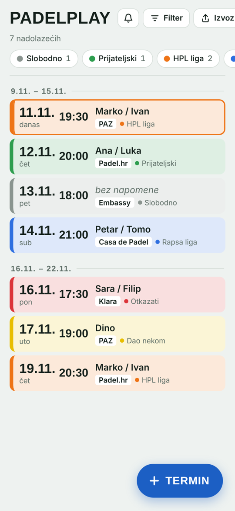
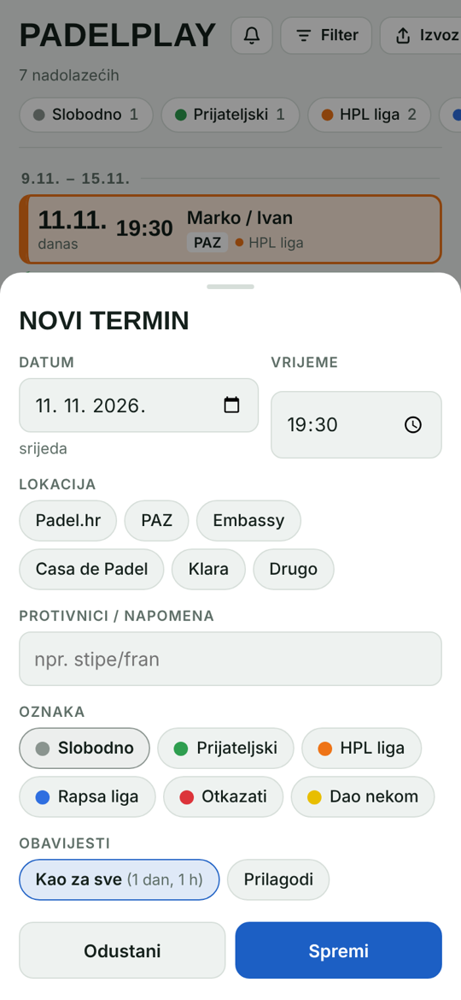
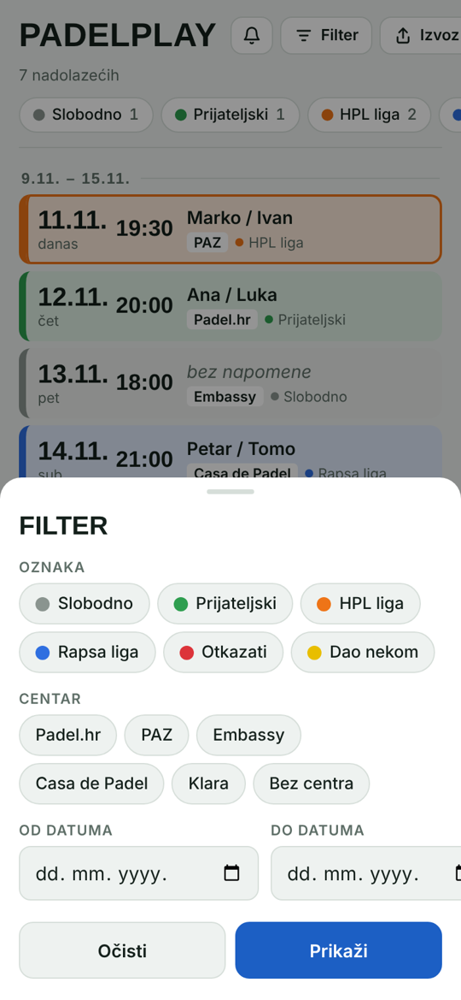
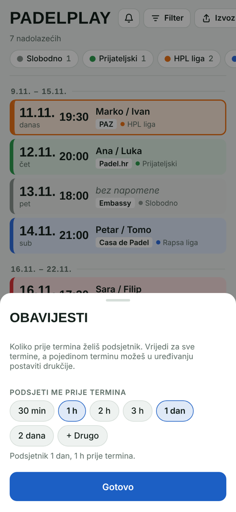
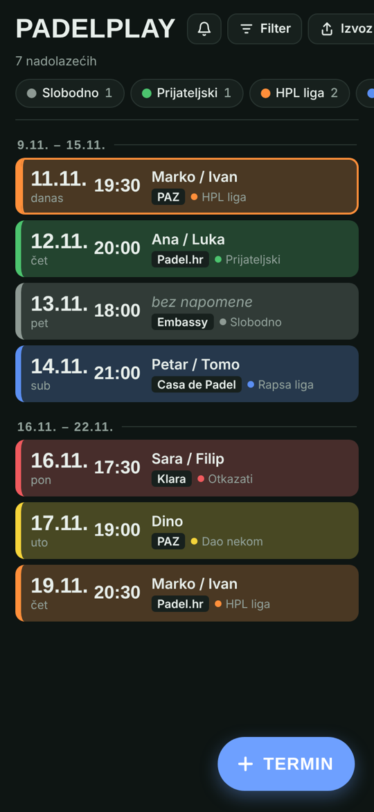

# PadelPlay

An Android app for organizing padel matches. Keep every booking in one list, color-code it by type
(league match, friendly, open slot, to cancel…), filter by court and date, and get reminders before
each match. I built it to replace the notepad I used for tracking matches across two Zagreb leagues.

> The interface is in Croatian.

  
  
  
  

## Features

- **Match list grouped by week**, with today's match highlighted and past matches hidden behind a toggle
- **Color-coded tags**: open slot, friendly, two leagues, *to cancel*, *given away*, with live counts per tag
- **Quick entry**: date, time, padel center (preset chips or custom), opponents/notes and tag
- **Filters** by several tags, several centers and a date range at once
- **Reminders** a day and an hour before each match by default. The lead times can be changed globally
  or per match. Matches marked *to cancel* get a reminder to cancel; *given away* matches get none
- **Export and share**: the current list as plain text, one line per match
  (`11.11. srijeda 19:30 h - PAZ - Marko/Ivan`), copied or shared to WhatsApp, Notes etc.
- **Light and dark theme** following the system setting
- **Offline**: all data stays on the phone, with no account and no server

  

## How it works

The app is a thin native Android shell around a single-page web UI:

| Part | Role |
|---|---|
| `assets/index.html` | The whole UI in plain HTML, CSS and JavaScript (no framework) |
| `MainActivity` | Hosts the UI in a `WebView` and exposes a small JavaScript bridge (`window.Android`) for saving, sharing, clipboard and notification settings |
| `Storage` | Persists matches and reminder settings as JSON in `SharedPreferences` |
| `Scheduler` | Turns matches into alarms with `AlarmManager` (exact alarms where allowed) and recalculates them on every change |
| `ReminderReceiver`, `Notifier` | Fire the notification when an alarm goes off |
| `BootReceiver` | Re-registers alarms after a reboot, app update or time/timezone change |

**Tech:** Java 17 · Android SDK 35 (min SDK 26) · Gradle Kotlin DSL · HTML/CSS/JavaScript

## Build and install

1. Install [Android Studio](https://developer.android.com/studio).
2. Clone the repository and open the folder in Android Studio (**File → Open**), then wait for Gradle sync.
3. **Build → Generate App Bundles or APKs → Generate APKs**.
4. Copy `app/build/outputs/apk/debug/app-debug.apk` to your phone and open it
   (allow installing from that source when asked).
5. On first start, allow notifications.

If reminders arrive late, set the app's battery usage to *Unrestricted*. Some Xiaomi, Huawei and
Samsung phones need this.

Detailed instructions in Croatian are in [UPUTE.md](UPUTE.md).
